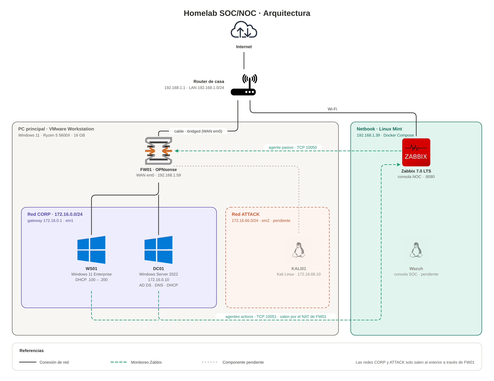
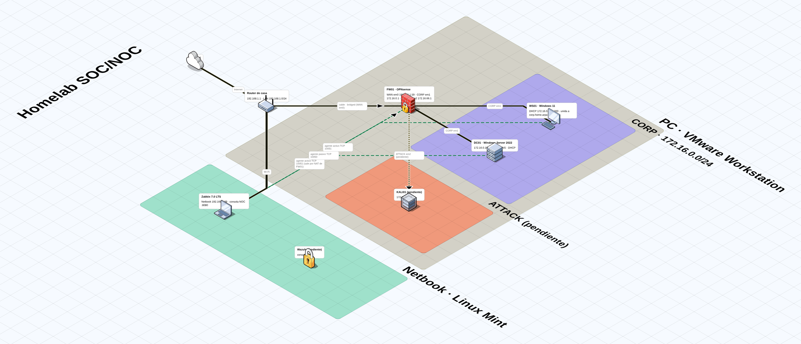
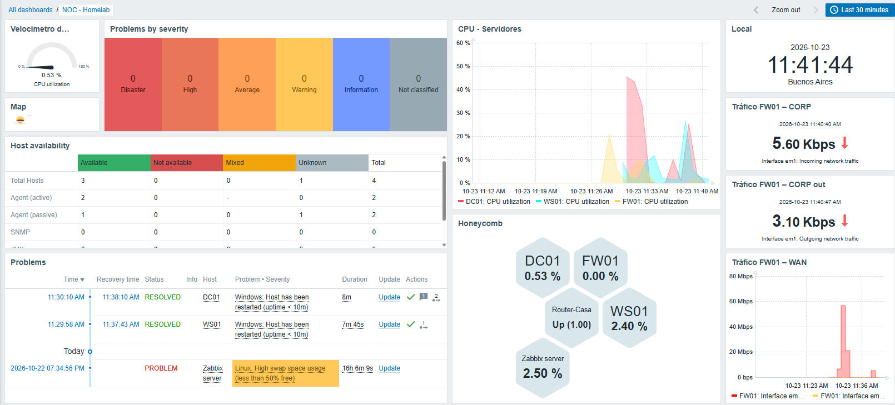
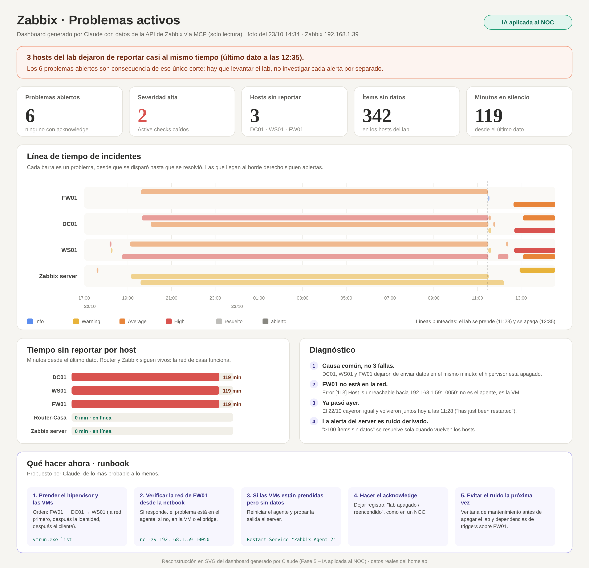

# Homelab SOC/NOC: Active Directory, OPNsense, Wazuh y Zabbix

Laboratorio propio que simula la red de una empresa chica para practicar tareas de **soporte IT N1/N2, NOC y SOC**: administración de Active Directory, automatización con PowerShell, firewall perimetral, monitoreo de infraestructura y detección de ataques.

> Punto de partida: el proyecto [Active Directory and PowerShell Automation](https://github.com/techgneek/Active-Directory-and-Powershell-Automation) de techgneek. Lo extendí con un firewall dedicado, una red de ataque aislada, un SIEM (Wazuh) y monitoreo NOC (Zabbix).

> Proyecto vinculado: [viewDI](https://github.com/blokxz/viewDI), una interfaz de terminal propia para administrar y monitorear contenedores **Docker** e **Incus**. En este lab sirve para manejar desde la netbook los contenedores de Zabbix: estado, logs, recursos y reinicios. Wazuh corre en una VM aparte (ver Fase 9) y no pasa por viewDI. Para un uso solo de monitoreo: `viewdi --read-only`.

---

## Contenido del repositorio

```
.
├── README.md                 # Documentación completa del lab
├── docs/
│   ├── arquitectura_svg.py   # Código que genera el diagrama de arquitectura
│   └── homelab-fossflow.json # Diagrama isométrico para FossFLOW
├── mcp/
│   └── claude_desktop_config.example.json  # Conexión de Claude Desktop a Zabbix (sin token)
├── zabbix/
│   ├── docker-compose.yml    # Zabbix 7.0 LTS: PostgreSQL + server + web + agente
│   ├── .env.example          # Plantilla de variables (copiar a .env)
│   ├── automation/
│   │   └── configure_noc.py  # Triggers, mantenimiento, notificación, auto-remediación y tickets (Fases 6 y 11)
│   └── simulate-incidents/   # Scripts para generar incidentes de prueba (Fases 6 y 11)
├── scripts/
│   ├── ad-bulk/               # OUs y alta masiva de usuarios por PowerShell (Fase 7)
│   └── gpo/                   # GPOs de contraseñas, bloqueo y auditoría (Fase 8)
├── wazuh/                     # Wazuh 4.9 (SOC) y config de Sysmon (Fase 9)
│   ├── docker-compose.yml
│   ├── generate-certs.yml
│   └── sysmon/sysmonconfig.xml
├── attack/                    # Simulaciones desde KALI01 y plantilla de reporte (Fase 10)
├── tickets/                   # GLPI (gestión de tickets) integrado con Zabbix (Fase 11)
├── iac/opnsense/               # Config versionado de FW01 + ejemplo de Ansible (Fase 11)
└── img/                       # Diagramas (2D e isométrico) y capturas del lab
    ├── README.md             # Lista de imágenes y capturas pendientes
    └── ia-dashboard.svg      # Fuente del dashboard generado por Claude (Fase 5)
```

---

## Objetivos

- Montar un dominio de Active Directory con DNS y DHCP.
- Automatizar el alta masiva de usuarios y OUs con PowerShell.
- Separar la red con un firewall perimetral (OPNsense) en lugar de hacer NAT en el controlador de dominio.
- Centralizar logs de seguridad en un SIEM (Wazuh + Sysmon).
- Monitorear disponibilidad y rendimiento con Zabbix.
- Simular ataques desde una red aislada y documentar cómo se detectan.

---

## Hardware

| Equipo | Specs | Rol |
|---|---|---|
| PC principal | Ryzen 5 5600X · 16 GB RAM · 1 TB · Windows 11 | Host de VMs (VMware Workstation Pro) |
| Netbook | Intel 11.ª gen · 8 GB RAM · 250 GB · Linux Mint | Consola SOC/NOC (Wazuh + Zabbix en Docker) |

Todo el proyecto vive en `C:\HOMELAB` (ISOs, VMs y repo), separado del resto del sistema. Para eliminarlo: desinstalar VMware y borrar la carpeta.

---

## Arquitectura



- **Líneas continuas:** conexiones de red. **Líneas verdes punteadas:** flujos de monitoreo de Zabbix (agentes activos de DC01 y WS01 por TCP 10051, que salen por el NAT de FW01; agente pasivo de FW01 por TCP 10050).
- **Wazuh y la red ATTACK** están diseñados pero todavía no implementados.
- Las redes CORP y ATTACK solo se comunican con el exterior a través de FW01 (ver *Segmentación*, más abajo).
- El diagrama se genera con código desde [`docs/arquitectura_svg.py`](docs/arquitectura_svg.py), usando los íconos de la librería [`diagrams`](https://diagrams.mingrammer.com/).

### Vista isométrica



Hecha con [FossFLOW](https://www.icewolfsoft.com/fossflow/). El archivo editable es [`docs/homelab-fossflow.json`](docs/homelab-fossflow.json) (en FossFLOW: menú → *Open*).

### Máquinas virtuales

| VM | SO | vCPU | RAM | Disco | Red |
|---|---|---|---|---|---|
| FW01 | OPNsense 26.7 | 2 | 2 GB | 20 GB | WAN: bridged · LAN: `corp` · OPT1: `attack` |
| DC01 | Windows Server 2022 Standard (Desktop Experience) | 2 | 4 GB | 60 GB | `corp` |
| WS01 | Windows 11 Enterprise | 2 | 4 GB | 64 GB | `corp` |
| KALI01 | Kali Linux (encendida solo para pruebas) | 2 | 2 GB | 40 GB | `attack` |

### Plan de direcciones

| Red | Rango | Gateway | Notas |
|---|---|---|---|
| CORP | 172.16.0.0/24 | 172.16.0.1 (FW01) | DC01 fijo en .10 · DHCP de DC01: .100–.200 |
| ATTACK | 172.16.66.0/24 | 172.16.66.1 (FW01) | Kali fija en .10 · sin DHCP |
| Casa | 192.168.1.0/24 | 192.168.1.1 | FW01 (WAN) y netbook con reserva DHCP |

**Dominio:** `corp.home.arpa` (NetBIOS `CORP`). Uso `home.arpa` porque es un nombre reservado para redes hogareñas (RFC 8375) y evita los conflictos que `.local` genera con mDNS en Linux.

### Segmentación: cómo se separa el lab de la red de casa

La separación la hace **FW01 (OPNsense)**, una VM con tres placas de red, cada una en una red distinta:

| Placa | Tipo en VMware | Red | Función |
|---|---|---|---|
| `em0` – WAN | **Bridged** a la placa física | Red de casa (`192.168.1.59`) | Salida a internet del lab |
| `em1` – LAN (CORP) | **LAN Segment** `corp` | `172.16.0.0/24` | Red corporativa: DC01 y WS01 |
| `em2` – OPT1 (ATTACK) | **LAN Segment** `attack` | `172.16.66.0/24` | Red de pruebas de ataque |

- **Los LAN Segments son switches virtuales aislados:** no tienen adaptador en el host ni conexión a la red física. Las VMs de CORP no tienen otro camino hacia afuera que pasar por FW01, que es su gateway (`172.16.0.1`).
- **Salida (CORP → internet):** FW01 enruta y hace **NAT**. Para la red de casa, todo el tráfico del lab viene de una sola IP, la de FW01.
- **Entrada (casa → lab):** **bloqueada por defecto**. Solo hay dos excepciones, puntuales y documentadas:
  - HTTPS a la GUI de FW01 desde la red de casa (administración).
  - TCP 10050 hacia FW01 **solo desde la IP de Zabbix** (`192.168.1.39`), para el agente pasivo.
- **Bloqueo de redes privadas en la WAN:** OPNsense lo trae activado porque asume que la WAN da directo a internet. Acá la WAN está dentro de una red privada, así que se desactivó para poder administrarlo (ver problema 5).
- **El controlador de dominio no rutea.** La guía original hacía NAT en el DC con RRAS; acá las funciones están separadas: FW01 maneja el tráfico y DC01 maneja identidades, DNS y DHCP.

**Cómo se verifica el aislamiento:**
- Si FW01 se apaga, DC01 y WS01 pierden la salida a internet: no hay otro camino.
- Desde la red de casa, `172.16.0.0/24` no es alcanzable. Por eso Zabbix no puede consultar a DC01 y WS01 directamente y se usan **agentes activos**, que inician la conexión desde adentro.

**¿Por qué una placa por red y no VLANs?** En VMware es más simple, y equivale a un firewall con un puerto físico por red. En producción lo habitual es una sola interfaz con VLANs etiquetadas hacia un switch (*router-on-a-stick*). El concepto es el mismo: redes aisladas que solo se comunican a través de las reglas del firewall.

### Política de firewall (FW01)

| Origen → Destino | Acción | Motivo | Estado |
|---|---|---|---|
| CORP → cualquiera | Permitir | Salida a internet y envío de métricas a la netbook | ✅ Aplicada |
| WAN (red de casa) → FW01 HTTPS | Permitir | Administración de la GUI web | ✅ Aplicada |
| `192.168.1.39` → FW01 TCP 10050 | Permitir | Agente Zabbix pasivo, solo desde la netbook | ✅ Aplicada |
| WAN → resto | Bloquear (por defecto) | Nada de la red de casa entra al lab | ✅ Aplicada |
| ATTACK → CORP | Permitir | Objetivo de las simulaciones de ataque | ⏳ Diseñada |
| ATTACK → 192.168.0.0/16 | Bloquear | Kali nunca toca la red de casa | ⏳ Diseñada |
| ATTACK → internet | Bloquear (regla deshabilitada por defecto) | Se habilita solo para actualizar Kali | ⏳ Diseñada |
| CORP → ATTACK | Bloquear | La red corporativa no inicia conexiones hacia la de ataque | ⏳ Diseñada |

> **Orden de las reglas:** OPNsense evalúa las reglas de cada interfaz de arriba hacia abajo y aplica la primera que coincide. Al implementar *CORP → ATTACK: Bloquear*, tiene que quedar **arriba** de *CORP → cualquiera: Permitir*; si no, nunca se aplica. Lo mismo en OPT1: los bloqueos hacia `192.168.0.0/16` e internet van antes de cualquier regla de permitir.

### Flujos de monitoreo

| Flujo | Protocolo / puerto | Dirección | Estado |
|---|---|---|---|
| Agentes Zabbix activos (DC01, WS01) → netbook | TCP 10051 | Saliente, atraviesa el NAT de FW01 | ✅ |
| Zabbix → agente de FW01 (pasivo) | TCP 10050 | Entrante a la WAN, solo desde la netbook | ✅ |
| Zabbix → router de casa | ICMP | Dentro de la red de casa | ✅ |
| Agentes Wazuh (DC01, WS01) → netbook | TCP 1514 / 1515 | Saliente, atraviesa el NAT de FW01 | ⏳ |
| Syslog de FW01 (incl. Suricata) → Wazuh | UDP 514 | Saliente | ⏳ |

---

## Estado del proyecto

- [x] Preparación del host (VMware Workstation Pro, estructura `C:\HOMELAB`)
- [x] **FW01**: OPNsense instalado, interfaces y reglas de administración
- [x] **DC01 – Parte 1**: Windows Server 2022, IP fija, conectividad verificada
- [x] **DC01 – Parte 2**: AD DS y DNS (`corp.home.arpa`)
- [x] **DC01 – Parte 2**: DHCP, usuario de prueba
- [x] **WS01**: Windows 11 unido al dominio
- [x] **NOC – Zabbix 7.0 LTS** en la netbook (Docker) con agentes en DC01, WS01 y FW01
- [ ] **NOC – Simulación de incidentes y tráfico** entre equipos (reinicio y servicio detenido ya validados en el lab; scripts de CPU/disco listos en `zabbix/simulate-incidents/`, Fase 6, falta correrlos; falta generación de tráfico entre equipos)
- [x] **NOC – Dashboard unificado** (*single pane of glass*): FW01, DC01, WS01 y router en una sola vista
- [x] **IA aplicada al NOC**: Claude + MCP de Zabbix, en modo solo lectura
- [ ] **NOC – Dependencias de triggers y notificaciones** (Fase 6: script listo en `zabbix/automation/`, falta correrlo contra el Zabbix real)
- [ ] **DC01 – Parte 3**: OUs y alta masiva de usuarios con PowerShell (Fase 7: script listo en `scripts/ad-bulk/`, falta correrlo contra DC01)
- [ ] GPOs y políticas de seguridad (Fase 8: script listo en `scripts/gpo/`, falta correrlo y validar con `Get-GPOReport`)
- [ ] **SOC**: Wazuh + Sysmon (Fase 9: `docker-compose.yml` y config de Sysmon listos en `wazuh/`, falta desplegar la VM)
- [ ] **Red ATTACK**: Kali, simulaciones y reportes de detección (Fase 10: scripts listos en `attack/`, falta correrlos y completar un informe real)
- [ ] **Auto-remediación**: comando remoto ante fallas conocidas (Fase 11: subcomando `remediate` listo en `zabbix/automation/`, falta habilitar `EnableRemoteCommands` en los agentes y probarlo)
- [ ] **Gestión de tickets**: GLPI integrado con Zabbix (Fase 11: `docker-compose.yml` listo en `tickets/`, falta desplegar la VM, generar los tokens de API y probar la apertura de tickets)
- [ ] **IaC para FW01**: config versionado + ejemplo de Ansible (Fase 11: scripts listos en `iac/opnsense/`, falta correr el primer backup real y, si se usa, instalar y probar la colección de Ansible)

---

## Fase 1 – FW01 (OPNsense)

### Red de VMware
- **VMnet0 (Bridged)** fijado a la placa física (`Realtek PCIe GbE Family Controller`), no en "Automatic".
- Segmentos LAN `corp` y `attack` creados desde la configuración de la VM (LAN Segments).

### VM
- Guest OS: FreeBSD 14 64-bit · 2 vCPU · 2 GB RAM · 20 GB.
- Adaptadores en orden: 1 Bridged (WAN) · 2 `corp` (LAN) · 3 `attack` (OPT1).

### Instalación y asignación de interfaces
1. Arranque desde la ISO → login `installer` / `opnsense` → instalación a disco.
2. Consola → opción 1 (*Assign interfaces*):

   | Interfaz | NIC | Adaptador VMware |
   |---|---|---|
   | WAN | `em0` | 1 – Bridged |
   | LAN | `em1` | 2 – `corp` |
   | OPT1 | `em2` | 3 – `attack` |

3. Consola → opción 2 (*Set interface IP address*):
   - WAN: DHCP (reserva en el router → `192.168.1.59`)
   - LAN: `172.16.0.1/24`, **sin servidor DHCP** (el DHCP de CORP lo da DC01)
   - OPT1: `172.16.66.1/24`, sin DHCP

### Configuración web
- Wizard: hostname `fw01`, dominio `corp.home.arpa`.
- WAN: **desactivados** *Block RFC1918 Private Networks* y *Block bogon networks*, porque la WAN está dentro de una red privada.
- LAN: DHCP de OPNsense desactivado.
- Unbound DNS: *Automatic DHCP/DNS registration* y *Optimize for Multiwan* desactivados.
- Regla WAN: `Pass · TCP · WAN net → This Firewall · HTTPS` (acceso a la GUI desde la LAN de casa).

---

## Fase 2 – DC01 (Windows Server 2022)

### Parte 1: instalación y red

VM: Windows Server 2022 · UEFI · 2 vCPU · 4 GB · 60 GB · una sola placa en el segmento `corp`. A diferencia de la guía original, **no lleva placa externa**: la salida a internet la da FW01.

Instalación manual (sin Easy Install de VMware) → edición *Standard Evaluation (Desktop Experience)* → VMware Tools.

```powershell
Get-NetAdapter | Select-Object Name, InterfaceDescription, Status

New-NetIPAddress -InterfaceAlias "Ethernet0" -IPAddress 172.16.0.10 -PrefixLength 24 -DefaultGateway 172.16.0.1
Set-DnsClientServerAddress -InterfaceAlias "Ethernet0" -ServerAddresses 172.16.0.1
Set-TimeZone -Id "Argentina Standard Time"
Rename-Computer -NewName "DC01" -Restart
```

Verificación:

```powershell
ping 172.16.0.1            # llega a FW01 (TTL=64, FreeBSD)
ping 8.8.8.8               # sale a internet por el NAT de FW01
Resolve-DnsName google.com # resuelve con el DNS de FW01 (Unbound)
```

Snapshot: `Base limpia - pre AD`.

### Parte 2: AD DS, DNS y DHCP

Hecho por la interfaz gráfica (Server Manager). Equivalente en PowerShell, por si hace falta automatizarlo:

```powershell
# AD DS + promoción
Install-WindowsFeature AD-Domain-Services -IncludeManagementTools
Install-ADDSForest -DomainName "corp.home.arpa" -DomainNetbiosName "CORP" -InstallDns -SafeModeAdministratorPassword (Read-Host -AsSecureString "Contraseña DSRM")

# DNS: DC01 se usa a sí mismo y reenvía a FW01
Set-DnsClientServerAddress -InterfaceAlias "Ethernet0" -ServerAddresses 127.0.0.1
Add-DnsServerForwarder -IPAddress 172.16.0.1

# DHCP
Install-WindowsFeature DHCP -IncludeManagementTools
Add-DhcpServerInDC -DnsName "dc01.corp.home.arpa" -IPAddress 172.16.0.10
netsh dhcp add securitygroups
Restart-Service dhcpserver
Add-DhcpServerv4Scope -Name "CORP" -StartRange 172.16.0.100 -EndRange 172.16.0.200 -SubnetMask 255.255.255.0 -State Active
Set-DhcpServerv4OptionValue -ScopeId 172.16.0.0 -Router 172.16.0.1 -DnsServer 172.16.0.10 -DnsDomain "corp.home.arpa"
```

Verificación:

```powershell
Get-ADDomain | Select-Object DNSRoot, NetBIOSName   # corp.home.arpa / CORP
Get-DnsServerZone                                   # corp.home.arpa y _msdcs.corp.home.arpa
nslookup dc01.corp.home.arpa                        # 172.16.0.10
nslookup google.com                                 # resuelve vía forwarder (FW01)
```

---

## Fase 3 – WS01 (Windows 11 Enterprise)

- VM: Windows 11 x64 · UEFI + vTPM (VMware cifra solo los archivos del TPM) · 2 vCPU · 4 GB · 64 GB · segmento `corp`.
- Cuenta local inicial `soporte` (sin cuenta Microsoft).
- Recibe IP por DHCP de DC01 (`172.16.0.1xx`, gateway `172.16.0.1`, DNS `172.16.0.10`, sufijo `corp.home.arpa`).
- Unida al dominio desde *System Properties → Change* (equivalente: `Add-Computer -DomainName "corp.home.arpa" -NewName "WS01" -Credential CORP\Administrator -Restart`).
- Login verificado con el usuario de dominio `uprueba@corp.home.arpa`.

---

## Fase 4 – NOC con Zabbix 7.0 LTS

Zabbix corre en la netbook (`192.168.1.39`) con Docker Compose: PostgreSQL, Zabbix server, frontend web (nginx, puerto 8080) y agente 2 local.

Los archivos están en la carpeta [`zabbix/`](zabbix/). La contraseña de la base de datos **no está en el repo**: se define en un archivo `.env` local, excluido por `.gitignore`.

```bash
mkdir -p ~/homelab/zabbix && cd ~/homelab/zabbix
# copiar docker-compose.yml y .env.example desde la carpeta zabbix/ del repo
cp .env.example .env
nano .env              # poner una contraseña propia en POSTGRES_PASSWORD
docker compose up -d
docker compose ps      # los 4 contenedores en "running"
```

Interfaz web: `http://192.168.1.39:8080` (usuario inicial `Admin` / `zabbix`, cambiar la contraseña en el primer acceso).

Para borrar todo: `docker compose down -v && sudo rm -rf ~/homelab/zabbix`.

### Hosts monitoreados

| Host | Método | Template | Grupo |
|---|---|---|---|
| Zabbix server | Agente pasivo (contenedor `zabbix-agent`) | Linux by Zabbix agent · Zabbix server health | Zabbix servers |
| DC01 | **Agente activo** (Zabbix agent 2, MSI) | Windows by Zabbix agent active | Lab/Windows |
| WS01 | **Agente activo** | Windows by Zabbix agent active | Lab/Windows |
| FW01 | **Agente pasivo** (plugin `os-zabbix7-agent`) | FreeBSD by Zabbix agent + item calculado *CPU utilization* | Lab/Firewall |
| Router-Casa | **ICMP** (sin agente) | ICMP Ping | Lab/Red |

**Por qué cada modo:**
- DC01 y WS01 están detrás del NAT de FW01: la netbook no puede alcanzar `172.16.0.0/24`, así que los agentes **inician** la conexión hacia `192.168.1.39:10051`.
- FW01 tiene su WAN en la red de casa, así que Zabbix lo consulta directamente en `192.168.1.59:10050`. Regla WAN: `Pass · TCP · 192.168.1.39 → This Firewall · 10050` (solo la netbook, solo ese puerto).
- El router de casa no admite agentes: se monitorea disponibilidad y latencia por ping.

**Item calculado en FW01:** el template de FreeBSD no trae un "CPU utilization" total, así que se creó uno para compararlo con los Windows:
- Type: *Calculated* · Key: `cpu.util.total` · Formula: `100-last(//system.cpu.util[,idle])` · Units: `%`

### Dashboard "NOC – Homelab" (*single pane of glass*)



Una sola pantalla con el estado, los problemas y el rendimiento de todo el lab:

| Widget | Qué muestra |
|---|---|
| **Honeycomb** | Un hexágono por equipo (DC01, WS01, FW01, router, Zabbix server) que cambia de color según su estado |
| **Problems by severity** | Cantidad de problemas activos por severidad |
| **Host availability** | Equipos disponibles / no disponibles, separados por agente activo y pasivo |
| **Problems** | Lista de problemas con línea de tiempo; desde acá se hace el *acknowledge* |
| **Graph – CPU** | CPU de DC01, WS01 y FW01 en la misma escala (FW01 vía item calculado) |
| **Graph – Tráfico FW01 WAN** | Tráfico de entrada y salida de `em0` (salida a internet) |
| **Item value – Tráfico CORP** | Tráfico actual de `em1` (red corporativa), entrada y salida |
| **Gauge** | CPU de DC01, con umbrales de color |

Se usa en modo **Kiosk** (pantalla completa sin menús), como en una pared de NOC.

**Validación:** se generaron incidentes reales (reinicio de DC01 y WS01, servicio detenido) y se siguió el ciclo completo: detección → *acknowledge* con comentario → resolución automática al volver el servicio.

---

## Operación diaria: apagar y encender el lab

Las dependencias marcan el orden: **FW01** da la red, **DC01** da DHCP, DNS y autenticación, y **WS01** depende de los dos.

### Apagar (de adentro hacia afuera)
1. **WS01** → Inicio → Apagar.
2. **DC01** → Inicio → Shut down (motivo: *Other (Planned)*).
3. **FW01** → consola → opción **5 (Power off system)** → `y`.
4. Cerrar VMware.
5. **Netbook:** se puede dejar encendida (Zabbix va a marcar los hosts caídos) o apagarla; los contenedores vuelven solos al reiniciar (`restart: unless-stopped`).

Se usa apagado del sistema operativo, no "Power Off" de VMware, para no corromper el AD ni la configuración del firewall.

### Encender (de afuera hacia adentro)
1. **Netbook** encendida y Zabbix arriba:
   ```bash
   cd ~/homelab/zabbix && docker compose up -d && docker compose ps
   ```
2. **FW01** → esperar el menú de consola con `WAN (em0) -> 192.168.1.59`.
3. **DC01** → esperar 2–3 minutos después del login. Verificar:
   ```powershell
   nslookup dc01.corp.home.arpa   # debe responder 172.16.0.10
   ```
   Si falla: `Restart-Service DNS` (ver problema 7).
4. **WS01** → `ipconfig` debe mostrar `172.16.0.1xx` (si muestra `169.254.x.x`, DC01 no estaba lista: `ipconfig /renew`).
5. **Zabbix** (`http://192.168.1.39:8080`) → en 3–5 minutos todos los hosts en verde y los problemas de la caída en *RESOLVED*.

---

## Fase 5 – IA aplicada al NOC (Claude + MCP de Zabbix)

Claude Desktop se conecta a la API de Zabbix mediante el protocolo **MCP** (*Model Context Protocol*), usando el servidor comunitario [zabbix-mcp-server](https://github.com/mpeirone/zabbix-mcp-server). Permite operar el monitoreo en lenguaje natural: consultar problemas, analizar incidentes, armar el resumen del turno y generar dashboards con datos reales.

```
PC Windows                                   Netbook (Mint)
┌────────────────────────────────┐          ┌───────────────────┐
│ Claude Desktop                 │          │ Zabbix (Docker)   │
│   └─ servidor MCP (uv) ────────┼── red ──▶│   API :8080       │
└────────────────────────────────┘          └───────────────────┘
```



*Dashboard que armó Claude consultando Zabbix por MCP (reconstruido en SVG con los datos reales del lab, [`img/ia-dashboard.svg`](img/ia-dashboard.svg)). Lo armó solo a partir del pedido "¿qué problemas activos hay en Zabbix?": resumen ejecutivo, KPIs, línea de tiempo de incidentes, tiempo sin reportar por host, diagnóstico y un runbook con los pasos a seguir.*

**Qué muestra:**
- **Conclusión arriba de todo:** los 3 hosts del lab dejaron de reportar a las 12:35; los 6 problemas abiertos son consecuencia de un único corte.
- **KPIs:** 6 problemas abiertos (ninguno con *acknowledge*), 2 de severidad alta, 3 hosts sin reportar, 342 ítems sin datos y 119 minutos de silencio.
- **Línea de tiempo:** el patrón se repite. El lab se apaga, Zabbix alerta y todo se resuelve al reencenderlo (11:28 del 23/10).
- **Tiempo sin reportar:** el router y el Zabbix server siguen en línea → la red de casa funciona y el problema está en la PC de las VMs.
- **Diagnóstico y runbook:** causa común (hipervisor apagado), FW01 inalcanzable (no es el agente), la alerta del server es ruido derivado; pasos ordenados de lo más probable a lo menos, con los comandos, y la recomendación de usar ventanas de mantenimiento y dependencias de triggers.

### Seguridad: defensa en profundidad (solo lectura)

| Capa | Configuración | Qué evita |
|---|---|---|
| 1. Usuario dedicado | `mcp-claude`, rol *User*, grupo con permiso **Read** sobre los hosts del lab | Que la IA tenga permisos de administrador |
| 2. Token propio | API token solo para este usuario, revocable | Compartir credenciales; si se expone, se rota sin afectar a nadie |
| 3. Modo del conector | `READ_ONLY=true` | Operaciones de escritura desde el MCP |
| 4. Lista blanca de métodos | `ZABBIX_API_WHITELIST=.*\.get` | Cualquier método que no sea de consulta |

**Prueba de la protección:** un intento de `host.create` desde Claude fue rechazado por el conector: *"Method 'host.create' is not in whitelist"*.

La configuración de ejemplo (sin token) está en [`mcp/claude_desktop_config.example.json`](mcp/claude_desktop_config.example.json). La ruta de `--directory` es la carpeta donde se clonó `zabbix-mcp-server` (en el ejemplo, `C:\HOMELAB\mcp\zabbix-mcp-server`, siguiendo la estructura del proyecto); hay que ajustarla si se clonó en otro lado.

### Caso real: correlación de eventos con IA

Con las VMs apagadas, Zabbix tenía **6 problemas activos**. Consultado por MCP, Claude los ordenó cronológicamente e identificó **una sola causa raíz**:

| Hora | Host | Problema |
|---|---|---|
| 12:39 | **FW01** | Zabbix agent is not available |
| 12:41 | WS01 / DC01 | Active checks are not available |
| 12:55 | Zabbix server | More than 100 items missing data |
| 13:04–13:05 | DC01 / WS01 | Agent not available (nodata 30m) |

> FW01 cayó primero; DC01 y WS01 dejaron de reportar porque sus datos pasan por el firewall, no porque estuvieran caídos. El resto de las alertas son consecuencias.

Es el caso que resuelven las **dependencias de triggers** (próximo paso): una falla debería producir una sola alerta.

### Ejemplos de uso

- *"¿Qué problemas activos hay? Ordenalos por severidad."*
- *"¿Cómo estuvo la CPU de DC01 en las últimas 24 horas?"*
- *"Hacé el resumen del turno: qué pasó, cuánto duró y qué sigue abierto."*
- *"Analizá este problema y proponé los pasos de un runbook."*

---

## Fase 6 – Dependencias de triggers, notificaciones y simulación de incidentes

> **Estado:** scripts y configuración listos en el repo; falta correrlos contra el Zabbix real del lab y validar el resultado (no hay acceso a la netbook desde donde se escribió esto).

Cierra lo que dejó abierto la Fase 5: que una sola falla (FW01 caído) produzca una sola alerta, no seis, y que el lab pueda avisar solo en vez de depender de que alguien mire el dashboard.

### Dependencias de triggers

[`zabbix/automation/configure_noc.py`](zabbix/automation/configure_noc.py) usa la API de Zabbix para encadenar los triggers según la causalidad real que encontró la IA en la Fase 5: el trigger "Zabbix agent is not available" de FW01 es la raíz, y de él dependen los de DC01/WS01 ("Active checks are not available") y el de "More than N items missing data" del Zabbix server. Con las dependencias cargadas, si cae FW01 los triggers que dependen de él no vuelven a abrir un problema nuevo mientras la raíz sigue activa.

```bash
export ZABBIX_URL="http://192.168.1.39:8080"
export ZABBIX_ADMIN_TOKEN="<token de un usuario Admin, no el mcp-claude de la Fase 5>"
python3 zabbix/automation/configure_noc.py dependencies --dry-run   # revisar antes de aplicar
python3 zabbix/automation/configure_noc.py dependencies
```

Necesita un usuario Admin de Zabbix, distinto del `mcp-claude` de solo lectura: la separación de la Fase 5 se mantiene, la IA sigue sin poder escribir en Zabbix.

### Ventana de mantenimiento para los apagados planeados

El mismo script abre una ventana de mantenimiento puntual sobre FW01/DC01/WS01 ("sin recolectar datos"), para que apagar el lab a propósito (ver "Operación diaria") no genere alertas:

```bash
python3 zabbix/automation/configure_noc.py maintenance --minutes 180
```

Se agrega como paso 0 antes de "Apagar (de adentro hacia afuera)".

### Notificaciones

`configure_noc.py notify` crea un media type de Telegram (webhook, sin necesidad de un servidor de correo) y una action que notifica ante cualquier problema de severidad Alta o superior, respetando la ventana de mantenimiento (`pause_suppressed`). El payload de la *action* queda documentado en el script para completarlo a mano con el `userid` del destinatario, porque no se pudo probar contra un Zabbix real antes de escribirlo.

### Simulación de incidentes

[`zabbix/simulate-incidents/`](zabbix/simulate-incidents/) tiene los scripts que faltaban para completar el ciclo completo (ya se había validado con un reinicio y un servicio detenido, ver Fase 4):

| Script | Dónde correrlo | Qué prueba |
|---|---|---|
| `cpu-stress.ps1` | DC01, WS01 | Trigger de CPU |
| `disk-fill.ps1` | DC01, WS01 | Trigger de espacio en disco |
| `cpu-stress-freebsd.sh` | FW01 (shell de consola) | Item calculado `cpu.util.total` |

Los tres se limpian solos (borran el archivo de prueba, matan los procesos de carga) al terminar el tiempo pedido o si se interrumpen.

---

## Fase 7 – DC01 Parte 3: OUs y alta masiva de usuarios con PowerShell

> **Estado:** script listo en el repo; falta correrlo contra el DC01 real y confirmar el alta en ADUC.

[`scripts/ad-bulk/New-LabOUsAndUsers.ps1`](scripts/ad-bulk/New-LabOUsAndUsers.ps1) reemplaza el alta manual por ADUC que se usó para el usuario de prueba (`uprueba`, Fase 2) por un proceso repetible:

- Crea la estructura `Lab/Soporte`, `Lab/Redes` y `Lab/Seguridad` bajo `corp.home.arpa` (idempotente: si una OU ya existe, la reutiliza).
- Da de alta en bloque los usuarios de un CSV ([`usuarios.csv.example`](scripts/ad-bulk/usuarios.csv.example) trae el formato), cada uno en su OU, con contraseña aleatoria, **deshabilitado** y forzado a cambiarla en el primer inicio de sesión — mismo criterio que se usó a mano con `uprueba`.

```powershell
Copy-Item usuarios.csv.example usuarios.csv   # editar con los usuarios reales
.\New-LabOUsAndUsers.ps1 -CsvPath .\usuarios.csv
```

Habilitar las cuentas después de revisarlas (`Enable-ADAccount`), para no dar de alta usuarios activos sin mirar el CSV antes.

---

## Fase 8 – GPOs y políticas de seguridad

> **Estado:** script listo en el repo, sin correr contra un DC01 real; la manipulación directa de `GptTmpl.inf` que usa para la política de contraseñas es una técnica conocida pero no se pudo validar en este lab. Antes de depender de ella, confirmar con `Get-GPOReport` que los valores quedaron aplicados como se espera, o aplicar la política de contraseñas a mano desde *Group Policy Management* (Computer Configuration → Policies → Windows Settings → Security Settings → Account Policies) si el script no se comporta como se documenta.

[`scripts/gpo/Set-LabGPOs.ps1`](scripts/gpo/Set-LabGPOs.ps1) crea y vincula:

- **Lab - Politica de contrasenas** (vinculada en el dominio): longitud mínima 12, complejidad, antigüedad máxima 90 días, historial de 12 contraseñas y bloqueo tras 5 intentos fallidos en 15 minutos. Password Policy y Account Lockout Policy viven en la misma GPO a propósito: en AD solo se puede aplicar una de cada por dominio (la de mayor prioridad gana), así que separarlas en dos GPOs distintas termina en que una pisa a la otra.
- **Lab - Auditoria avanzada** (vinculada en la OU `Lab`, creada en la Fase 7): habilita las subcategorías de auditoría que va a necesitar Wazuh en la Fase 9 — validación de credenciales, logon, bloqueo de cuenta, gestión de grupos y usuarios, uso de privilegios sensibles.

```powershell
.\Set-LabGPOs.ps1
gpupdate /force                                          # en DC01 y en los equipos del dominio
Get-GPOReport -All -ReportType Html -Path gpo-report.html # para confirmar los valores aplicados
```

---

## Fase 9 – SOC: Wazuh + Sysmon

> **Estado:** `docker-compose.yml`, generación de certificados y config de Sysmon listos en el repo; no se probaron contra una instalación real. Ver "Qué falta validar" en [`wazuh/README.md`](wazuh/README.md) antes de desplegar.

A diferencia de Zabbix, **Wazuh no corre en la netbook**: el indexer (OpenSearch) pide 4 GB+ de RAM él solo, y la netbook ya tuvo un incidente real de swap con solo Zabbix arriba (ver problema 10, más abajo). Corre en una VM Linux aparte en el host de VMware — coherente con la decisión de diseño "Zabbix para métricas, OPNsense/Wazuh para logs".

```
PC Windows (VMware)
┌──────────────────────────────┐
│ VM Wazuh (Linux, Docker)     │
│   indexer + manager + dashboard
└──────────────────────────────┘
        ▲ agentes (1514/1515)         ▲ syslog (514/UDP)
        │                              │
     DC01 / WS01                      FW01 (OPNsense)
```

Instalación, agentes y la configuración de Sysmon para DC01/WS01 están documentados en [`wazuh/README.md`](wazuh/README.md). Resumen:

1. Levantar la VM, generar los certificados TLS y `docker compose up -d` (ver el README de la carpeta).
2. Instalar el agente de Wazuh en DC01 y WS01 (aparte del agente de Zabbix: métricas y seguridad quedan separadas).
3. Instalar Sysmon con [`wazuh/sysmon/sysmonconfig.xml`](wazuh/sysmon/sysmonconfig.xml): procesos, conexiones de red, carga de drivers, hilos remotos, acceso a `lsass.exe`/`winlogon.exe` y cambios de registro en rutas de persistencia — la telemetría que necesita la Fase 10.
4. Apuntar el syslog de FW01 (y Suricata, si se instala) a la VM de Wazuh.

Igual que DC01 y WS01 con Zabbix, están detrás del NAT de FW01: la forma más simple es poner la VM de Wazuh directamente en la red `corp` de VMware, para que los agentes la alcancen sin pasar por NAT.

---

## Fase 10 – Red ATTACK: Kali, simulaciones y reportes de detección

> **Estado:** scripts listos en el repo, pensados para correr desde KALI01 contra CORP; no se ejecutaron contra el lab real. Antes de usarlos, confirmar que la regla "ATTACK → 192.168.0.0/16: Bloquear" está aplicada (ver "Política de firewall", más arriba) para que nada salga hacia la red de casa.

[`attack/`](attack/) tiene tres escenarios chicos, pensados para generar telemetría y practicar detección, no para explotar nada de verdad:

| Script | Simula | Qué debería ver Wazuh |
|---|---|---|
| [`recon.sh`](attack/recon.sh) | Descubrimiento de hosts y puertos en CORP (`nmap`) | Base para correlacionar los pasos siguientes |
| [`bruteforce-rdp.sh`](attack/bruteforce-rdp.sh) | Fuerza bruta de RDP contra WS01 (`hydra` + wordlist chica) | Varios 4625 seguidos de un 4624 desde la misma IP |
| [`persist-registry.ps1`](attack/persist-registry.ps1) | Persistencia vía `Run` key, ya "dentro" de WS01 | Evento Sysmon 13 sobre `CurrentVersion\Run` |

[`attack/informe-deteccion.md`](attack/informe-deteccion.md) es la plantilla para documentar cada corrida: línea de tiempo, qué disparó en Wazuh, qué no se detectó y por qué, y causa raíz — mismo criterio que usó la IA en la Fase 5 para los seis problemas de Zabbix.

El orden sugerido y los requisitos previos (reglas de FW01, Sysmon instalado, un usuario de prueba con una contraseña de la wordlist) están en [`attack/README.md`](attack/README.md).

---

## Fase 11 – Auto-remediación, gestión de tickets e IaC

> **Estado:** scripts y configuración listos en el repo; falta correrlos contra el hardware real del lab, ver el detalle de cada parte más abajo.

Cierra la brecha entre "monitorear" y lo que en una NOC real se espera además: que algunas fallas se arreglen solas, que lo que no se arregla solo genere un ticket en vez de depender de que alguien mire el dashboard, y que la configuración de la red viva como código versionado y no solo en la memoria de quien hizo el último cambio por la GUI.

| | NOC tradicional | Con esta fase |
|---|---|---|
| **Monitoreo** | El operador mira el dashboard esperando que algo cambie a rojo | Dependencias de triggers (Fase 6) agrupan la cascada de alertas de una sola falla |
| **Resolución de fallas** | Se abre un ticket y alguien ejecuta comandos manuales | Zabbix corre un comando remoto (reiniciar el servicio) en el momento, antes de avisar a una persona |
| **Gestión de tickets** | Los tickets se crean y categorizan a mano | Un problema de severidad alta abre un ticket solo en GLPI |
| **Configuraciones** | Entrar por consola/GUI línea por línea | El `config.xml` de FW01 queda versionado en git, con diff entre cambios |

### Auto-remediación

`zabbix/automation/configure_noc.py remediate` crea una *action* de Zabbix que, al disparar un trigger puntual en un host puntual, corre un comando remoto en ese mismo host (vía el agente de Zabbix) antes de avisar a una persona. Ejemplo pensado para probarlo sin esperar una falla real: el servicio *Cola de impresión* (Spooler) en WS01.

```bash
python3 zabbix/automation/configure_noc.py remediate \
    --host WS01 --trigger-substr "Spooler" \
    --command 'powershell -Command "Start-Service Spooler"' --dry-run
```

[`zabbix/simulate-incidents/toggle-service.ps1`](zabbix/simulate-incidents/toggle-service.ps1) detiene (o arranca) el servicio a mano para disparar el trigger y ver si la auto-remediación actúa.

**Esto necesita `EnableRemoteCommands=1` en el agente del host de destino** (viene en 0 por defecto, a propósito: habilitarlo le da a quien controle Zabbix ejecución de comandos en ese host). Usarlo solo para fallas de bajo riesgo y conocidas, nunca para reiniciar un equipo entero. El mecanismo deja un solo intento (`esc_step_to: 1`): si sigue fallando, pasa a notificar a una persona en vez de reintentar en bucle.

### Gestión de tickets (GLPI)

[`tickets/`](tickets/) levanta GLPI (en la misma VM que Wazuh, no en la netbook, mismo motivo que la Fase 9) y `configure_noc.py tickets` crea el media type que lo conecta con Zabbix: un problema de severidad alta abre un ticket solo, con el host y la descripción del evento. Ver [`tickets/README.md`](tickets/README.md) para generar los tokens de API de GLPI (paso manual, GLPI no trae su API habilitada por defecto).

### IaC para FW01

OPNsense no tiene un motor declarativo como Terraform, así que [`iac/opnsense/`](iac/opnsense/) combina dos cosas:

- [`backup-config.sh`](iac/opnsense/backup-config.sh) descarga el `config.xml` de FW01 por su API, lo sanitiza (contraseñas, claves privadas) y lo deja listo para comitear — poder ver con `git diff` qué cambió entre dos backups, y volver atrás con [`restore-config.sh`](iac/opnsense/restore-config.sh) si algo salió mal.
- [`iac/opnsense/ansible/`](iac/opnsense/ansible/) es un ejemplo, sin probar, de declarar un puñado de recursos (alias de firewall) con la colección comunitaria `ansibleguy.opnsense`.

Sumado a las Fases 7 y 8 (OUs/usuarios y GPOs por PowerShell) y a esta parte de Zabbix, el lab completo queda descrito como código: AD, GPOs, FW01 y la configuración de Zabbix/tickets, cada uno en su propio formato, pero todos versionados en este repo en vez de vivir solo en la memoria de quien hizo el cambio.

---

## Problemas encontrados y soluciones

### 1. VMware sin redes virtuales
- **Síntoma:** al encender FW01, *"No se ha podido conectar 'Ethernet0' a la red virtual 'VMnet0'"*. El Virtual Network Editor estaba vacío.
- **Causa:** VMware no tenía instaladas sus redes virtuales.
- **Solución:** Virtual Network Editor como administrador → *Restore Defaults* (aparecieron VMnet1 y VMnet8) → *Add Network* VMnet0 → Bridged a la placa física.

### 2. Arranque por PXE
- **Síntoma:** `No boot filename received … PXE … exiting Intel PXE ROM`.
- **Causa:** la VM no encontraba un medio de arranque (ISO no conectada).
- **Solución:** CD/DVD → *Use ISO image file* con *Connect at power on*. La ISO de OPNsense viene como `.iso.bz2` y hay que descomprimirla.

### 3. OPNsense usando la IP del router
- **Síntoma:** `arp: … is using my IP address 192.168.1.1 on em0!`
- **Causa:** la instalación por defecto asigna la **LAN** a `em0` con `192.168.1.1/24`. Como `em0` era la placa bridged, FW01 competía con el router de casa por la misma IP (y podía repartir DHCP en la red doméstica).
- **Solución:** desconectar el adaptador bridged, reasignar interfaces (WAN `em0`, LAN `em1`, OPT1 `em2`), cargar las IPs del lab y recién después reconectar la WAN.
- **Aprendizaje:** nunca conectar un firewall recién instalado a una red productiva antes de asignar sus interfaces.

### 4. Falta de memoria en OPNsense
- **Síntoma:** `pid … (python3.13) … was killed: failed to reclaim memory` y caída a `Enter full pathname of shell or RETURN for /bin/sh` (modo de usuario único), con errores de `config.inc` en el menú.
- **Causa:** RAM insuficiente asignada a la VM.
- **Solución:** subir a 2 GB y reinstalar.

### 5. Sin acceso a la GUI web
- **Síntoma:** `ERR_CONNECTION_TIMED_OUT` al entrar a `https://192.168.1.59` aun con una regla *Pass* en la WAN.
- **Diagnóstico:**
  - Con `pfctl -d` (firewall apagado temporalmente) la GUI respondía → el problema era de reglas, no de red.
  - En *Automatically generated rules* aparecía **"Block private networks from WAN"** (`192.168.0.0/16`), que se evalúa antes que las reglas del usuario.
- **Causa:** OPNsense asume que la WAN da directo a internet y bloquea orígenes privados; en el lab la WAN está dentro de la red de casa.
- **Solución:** Interfaces → WAN → desactivar *Block private networks* y *Block bogon networks* → `pfctl -e`.

### 6. WAN sin IP después de reiniciar
- **Síntoma:** la WAN aparecía vacía en la consola.
- **Causa:** el adaptador bridged quedó con *Connect at power on* desactivado.
- **Solución:** reconectar el adaptador, dejar la opción tildada y reservar la IP en el router.

### 7. El dominio no resolvía su propio nombre
- **Síntoma:** después de promover DC01, `nslookup dc01.corp.home.arpa` devolvía *Non-existent domain*, aunque `google.com` resolvía bien. La consola DNS no mostraba zonas.
- **Diagnóstico:** `Get-ADDomain` confirmaba que el dominio existía → el problema era el DNS, no el AD.
- **Causa:** el servicio DNS arrancó antes de que Active Directory estuviera listo y no cargó las zonas integradas en AD.
- **Solución:** `Restart-Service DNS` → `Get-DnsServerZone` mostró `corp.home.arpa` y `_msdcs.corp.home.arpa` → `ipconfig /registerdns` y `Restart-Service netlogon` para registrar los registros del DC. La consola gráfica requería cerrarse y abrirse de nuevo para mostrar los cambios.

### 8. Usuario de dominio sin poder iniciar sesión en WS01
- **Síntoma:** *"The user name or password is incorrect"* con `CORP\uprueba`.
- **Revisión (ticket típico de N1):** distribución de teclado en la pantalla de login, Bloq Mayús, nombre de inicio de sesión real en ADUC.
- **Solución:** *Reset Password* en ADUC (sin "must change password", con *Unlock account*) y login con el formato `uprueba@corp.home.arpa`.

### 9. FW01 no respondía al monitoreo pasivo de Zabbix
- **Síntoma:** en Zabbix, *"cannot establish TCP connection to [[192.168.1.59]:10050]: timed out"* y el problema *"FreeBSD: Zabbix agent is not available"*.
- **Diagnóstico:**
  - `nc -zv 192.168.1.59 10050` desde la netbook → timeout. `curl -k https://192.168.1.59` → OK, así que la red estaba bien y el problema era puntual del puerto 10050.
  - La regla WAN tenía primero la IP de origen equivocada (`.59` en lugar de `.39`). Corregida, seguía fallando.
  - Como OPNsense descarta en silencio los paquetes a puertos cerrados, un agente que no escucha se ve desde afuera igual que un bloqueo del firewall.
- **Causa:** en el plugin del agente, **Listen IPs** tenía `192.168.1.39` (la IP de la netbook). Ese campo es la IP **propia de FW01** donde el agente escucha; el agente no podía escuchar en una dirección que no le pertenece.
- **Solución:** *Listen IPs* = `0.0.0.0` y *Zabbix Servers* = `192.168.1.39` (quién tiene permiso para consultar).
- **Aprendizaje:** distinguir "dónde escucha el servicio" de "quién puede conectarse", y verificar del lado del servidor (servicio y puerto en escucha) antes de culpar al firewall.

### 10. Alerta de swap en la netbook (primer incidente real detectado por Zabbix)
- **Síntoma:** en el dashboard, *"Linux: High swap space usage (less than 50% free)"* en el host *Zabbix server*, abierto durante más de 16 horas.
- **Hallazgo extra:** el widget *Problems by severity* mostraba 0 problemas porque filtraba solo los grupos `Lab/*`, y el host estaba en `Zabbix servers`. Se agregó el grupo al widget.
- **Diagnóstico:** `free -h`, `ps aux --sort=-%mem` → la memoria la consumían los navegadores (Brave y Google Chrome) abiertos en la netbook, no los contenedores de Zabbix.
- **Solución:** se cerraron los navegadores; el uso de swap bajó y el problema se resolvió solo. Se documentó con *acknowledge* en Zabbix.
- **Aprendizaje:** el equipo que monitorea no debería usarse como estación de trabajo; compartir sus recursos afecta al servicio. Es un antecedente a tener en cuenta antes de sumar Wazuh, que pide más RAM.

### 11. El MCP de Zabbix no arrancaba en Claude Desktop
- **Síntoma:** en el log de Claude Desktop, `error: El sistema no puede encontrar la ruta especificada. (os error 3)` y *"Server transport closed unexpectedly"*.
- **Diagnóstico:** el mismo comando ejecutado a mano en PowerShell (`uv run --directory ... zabbix-mcp`) arrancaba bien → el problema estaba en la configuración, no en el servidor.
- **Causa:** la configuración seguía con una ruta vieja y con el punto de entrada de una versión anterior del proyecto (`python src/zabbix_mcp_server.py`); la versión actual se ejecuta como `zabbix-mcp`.
- **Segundo problema:** después de rotar el token, una de las instancias del MCP seguía usando el anterior (*"Session terminated, re-login"*). Se resolvió cerrando Claude Desktop por completo (incluidos los procesos en segundo plano).

---

## Decisiones de diseño

- **OPNsense en lugar de RRAS en el DC:** el controlador de dominio no debería rutear tráfico. Es el equipo más crítico (si cae, cae el dominio) y meterlo en el camino de todo el tráfico suma superficie de ataque. Cada equipo cumple una función: FW01 maneja el tráfico, DC01 las identidades.
- **Gateway del DHCP = FW01 (`172.16.0.1`):** la guía original usa un gateway (`.2`) que no coincide con el equipo que hace NAT.
- **Agentes Zabbix en modo activo:** las VMs están detrás del NAT de FW01; si los agentes inician la conexión, no hace falta abrir puertos entrantes.
- **Red ATTACK aislada:** permite practicar ataques contra CORP sin exponer la red doméstica.
- **Zabbix fuera del host de VMs:** corre en la netbook para que el monitoreo sea independiente de lo que monitorea. Si la PC con las VMs se cae, Zabbix lo detecta y alerta.
- **Zabbix para métricas, OPNsense/Wazuh para logs:** Zabbix concentra estado y rendimiento de todo el lab en un solo dashboard; el detalle de conexiones permitidas o bloqueadas se consulta en OPNsense (y luego en Wazuh).
- **Wazuh en una VM aparte, no en la netbook:** el indexer de Wazuh (OpenSearch) pide 4 GB+ de RAM él solo, y la netbook ya se quedó corta de RAM con solo Zabbix (ver problema 10). Separar el SOC del NOC en hardware distinto también evita que un pico de uno tape las métricas del otro.
- **GLPI junto a Wazuh, no junto a Zabbix:** mismo motivo de RAM que Wazuh; además, tanto GLPI como Wazuh son "destino" de eventos (tickets, alertas de seguridad), así que tiene más sentido agruparlos entre sí que con la fuente de métricas.
- **Auto-remediación con un solo intento, nunca en bucle:** si el comando remoto no resuelve la falla, lo correcto es escalar a una persona, no reintentar indefinidamente algo que ya se demostró que no funciona.
- **Config de FW01 versionado en vez de un motor IaC de terceros:** OPNsense no tiene un Terraform/Ansible oficial con cobertura completa; versionar el `config.xml` sanitizado cubre el 100% de la configuración (aunque sin aplicar cambios puntuales), y Ansible queda reservado para los pocos recursos que la colección comunitaria sí cubre bien.
- **Dependencias de triggers con FW01 como raíz:** se eligió FW01 porque fue la causa real del único incidente multi-alerta que se dio en el lab (Fase 5); si aparece otro patrón de falla en cascada, conviene revisar las dependencias en vez de asumir que esta cadena cubre todos los casos.

---

## Próximos pasos

Las Fases 6 a 11 ya tienen scripts y configuración en el repo (ver cada sección más arriba), pero ninguna se corrió todavía contra el hardware real del lab. El orden sugerido para validarlas:

1. **Fase 6** — correr `configure_noc.py dependencies --dry-run`, revisar el payload, aplicarlo, y recién ahí probar los scripts de `simulate-incidents/` para confirmar que una sola falla (por ejemplo, apagar FW01) genera una sola alerta visible.
2. **Fase 6** — configurar un bot de Telegram propio y correr `configure_noc.py notify`, completando a mano el `userid` de la *action* como indica el script.
3. **Fase 7** — completar un CSV real de usuarios y correr `New-LabOUsAndUsers.ps1`, habilitar las cuentas que correspondan.
4. **Fase 8** — correr `Set-LabGPOs.ps1` y confirmar con `Get-GPOReport` que la política de contraseñas y la auditoría quedaron aplicadas en DC01 y WS01.
5. **Fase 9** — levantar la VM de Wazuh, generar los certificados, instalar los agentes y Sysmon en DC01/WS01, y apuntar el syslog de FW01.
6. **Fase 10** — con Wazuh ya recibiendo telemetría, correr los tres escenarios de `attack/` desde KALI01 y completar un `informe-deteccion.md` real.
7. **Fase 11** — habilitar `EnableRemoteCommands` en el agente de WS01 y probar `remediate` con `toggle-service.ps1` antes de confiar en él para una falla real.
8. **Fase 11** — levantar GLPI en la misma VM que Wazuh, generar los tokens de API y probar `configure_noc.py tickets` desde *Media types → Test* en Zabbix antes de la primera falla real.
9. **Fase 11** — correr `backup-config.sh` una vez contra FW01 para tener el primer snapshot versionado, y revisar el ejemplo de Ansible (`iac/opnsense/ansible/`) contra la documentación actual de `ansibleguy.opnsense` antes de instalarlo.
10. Generación de tráfico entre equipos (métricas en Zabbix, logs en OPNsense) para tener una línea de base contra la que comparar los incidentes simulados.
11. Revisar `wazuh/README.md` → "Qué falta validar" antes del paso 5: los nombres de archivo de certificados y las versiones de imagen pueden haber cambiado.
