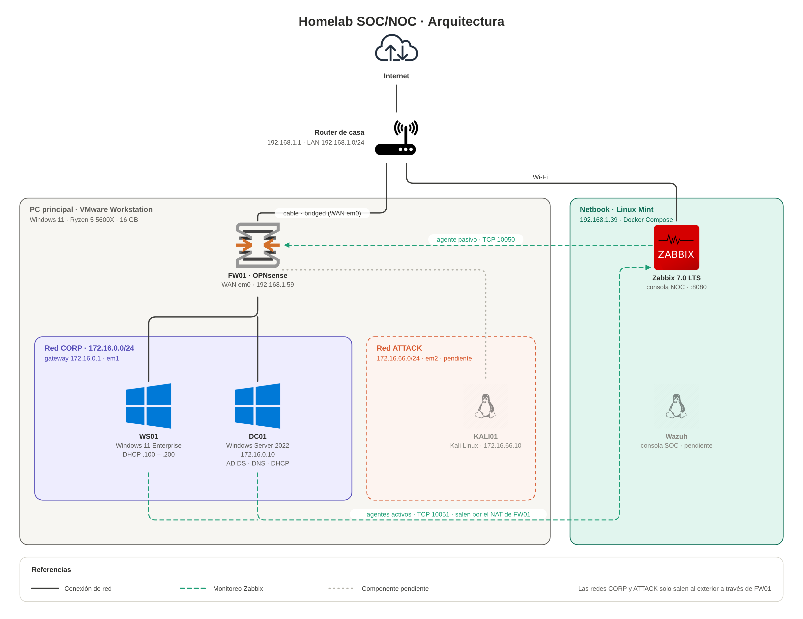
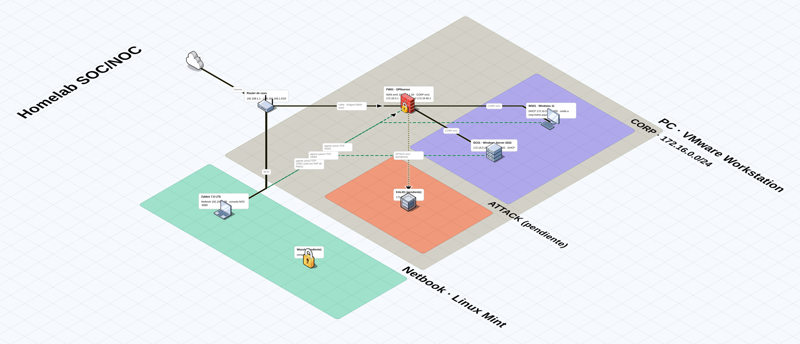

# Homelab SOC/NOC: Active Directory, OPNsense, Wazuh y Zabbix

Laboratorio propio que simula la red de una empresa chica para practicar tareas de **soporte IT N1/N2, NOC y SOC**: administración de Active Directory, automatización con PowerShell, firewall perimetral, monitoreo de infraestructura y detección de ataques.

> Punto de partida: el proyecto [Active Directory and PowerShell Automation](https://github.com/techgneek/Active-Directory-and-Powershell-Automation) de techgneek. Lo extendí con un firewall dedicado, una red de ataque aislada, un SIEM (Wazuh) y monitoreo NOC (Zabbix).

---

## Contenido del repositorio

```
.
├── README.md                 # Documentación completa del lab
├── docs/
│   ├── arquitectura_svg.py   # Código que genera el diagrama de arquitectura
│   └── homelab-fossflow.json # Diagrama isométrico para FossFLOW
├── zabbix/
│   ├── docker-compose.yml    # Zabbix 7.0 LTS: PostgreSQL + server + web + agente
│   └── .env.example          # Plantilla de variables (copiar a .env)
└── img/                      # Diagramas (2D e isométrico) y capturas del lab
```

---

## Objetivos

- Montar un dominio de Active Directory con DNS y DHCP.
- Automatizar el alta masiva de usuarios y OUs con PowerShell.
- Separar la red con un firewall perimetral (OPNsense) en lugar de hacer NAT en el controlador de dominio.
- Centralizar logs de seguridad en un SIEM (Wazuh + Sysmon).
- Monitorear disponibilidad y rendimiento con Zabbix.
- Simular ataques desde una red aislada y documentar cómo se detectan.

---

## Hardware

| Equipo | Specs | Rol |
|---|---|---|
| PC principal | Ryzen 5 5600X · 16 GB RAM · 1 TB · Windows 11 | Host de VMs (VMware Workstation Pro) |
| Netbook | Intel 11.ª gen · 8 GB RAM · 250 GB · Linux Mint | Consola SOC/NOC (Wazuh + Zabbix en Docker) |

Todo el proyecto vive en `C:\HOMELAB` (ISOs, VMs y repo), separado del resto del sistema. Para eliminarlo: desinstalar VMware y borrar la carpeta.

---

## Arquitectura



- **Líneas continuas:** conexiones de red. **Líneas verdes punteadas:** flujos de monitoreo de Zabbix (agentes activos de DC01 y WS01 por TCP 10051, que salen por el NAT de FW01; agente pasivo de FW01 por TCP 10050).
- **Wazuh y la red ATTACK** están diseñados pero todavía no implementados.
- El diagrama se genera con código desde [`docs/arquitectura_svg.py`](docs/arquitectura_svg.py), usando los íconos de la librería [`diagrams`](https://diagrams.mingrammer.com/).

### Vista isométrica



Hecha con [FossFLOW](https://www.icewolfsoft.com/fossflow/). El archivo editable es [`docs/homelab-fossflow.json`](docs/homelab-fossflow.json) (en FossFLOW: menú → *Open*).
- Las redes CORP y ATTACK solo se comunican con el exterior a través de FW01 (ver *Segmentación*, más abajo).

### Máquinas virtuales

| VM | SO | vCPU | RAM | Disco | Red |
|---|---|---|---|---|---|
| FW01 | OPNsense 26.7 | 2 | 2 GB | 20 GB | WAN: bridged · LAN: `corp` · OPT1: `attack` |
| DC01 | Windows Server 2022 Standard (Desktop Experience) | 2 | 4 GB | 60 GB | `corp` |
| WS01 | Windows 11 Enterprise | 2 | 4 GB | 64 GB | `corp` |
| KALI01 | Kali Linux (encendida solo para pruebas) | 2 | 2 GB | 40 GB | `attack` |

### Plan de direcciones

| Red | Rango | Gateway | Notas |
|---|---|---|---|
| CORP | 172.16.0.0/24 | 172.16.0.1 (FW01) | DC01 fijo en .10 · DHCP de DC01: .100–.200 |
| ATTACK | 172.16.66.0/24 | 172.16.66.1 (FW01) | Kali fija en .10 · sin DHCP |
| Casa | 192.168.1.0/24 | 192.168.1.1 | FW01 (WAN) y netbook con reserva DHCP |

**Dominio:** `corp.home.arpa` (NetBIOS `CORP`). Uso `home.arpa` porque es un nombre reservado para redes hogareñas (RFC 8375) y evita los conflictos que `.local` genera con mDNS en Linux.

### Segmentación: cómo se separa el lab de la red de casa

La separación la hace **FW01 (OPNsense)**, una VM con tres placas de red, cada una en una red distinta:

| Placa | Tipo en VMware | Red | Función |
|---|---|---|---|
| `em0` – WAN | **Bridged** a la placa física | Red de casa (`192.168.1.59`) | Salida a internet del lab |
| `em1` – LAN (CORP) | **LAN Segment** `corp` | `172.16.0.0/24` | Red corporativa: DC01 y WS01 |
| `em2` – OPT1 (ATTACK) | **LAN Segment** `attack` | `172.16.66.0/24` | Red de pruebas de ataque |

- **Los LAN Segments son switches virtuales aislados:** no tienen adaptador en el host ni conexión a la red física. Las VMs de CORP no tienen otro camino hacia afuera que pasar por FW01, que es su gateway (`172.16.0.1`).
- **Salida (CORP → internet):** FW01 enruta y hace **NAT**. Para la red de casa, todo el tráfico del lab viene de una sola IP, la de FW01.
- **Entrada (casa → lab):** **bloqueada por defecto**. Solo hay dos excepciones, puntuales y documentadas:
  - HTTPS a la GUI de FW01 desde la red de casa (administración).
  - TCP 10050 hacia FW01 **solo desde la IP de Zabbix** (`192.168.1.39`), para el agente pasivo.
- **Bloqueo de redes privadas en la WAN:** OPNsense lo trae activado porque asume que la WAN da directo a internet. Acá la WAN está dentro de una red privada, así que se desactivó para poder administrarlo (ver problema 5).
- **El controlador de dominio no rutea.** La guía original hacía NAT en el DC con RRAS; acá las funciones están separadas: FW01 maneja el tráfico y DC01 maneja identidades, DNS y DHCP.

**Cómo se verifica el aislamiento:**
- Si FW01 se apaga, DC01 y WS01 pierden la salida a internet: no hay otro camino.
- Desde la red de casa, `172.16.0.0/24` no es alcanzable. Por eso Zabbix no puede consultar a DC01 y WS01 directamente y se usan **agentes activos**, que inician la conexión desde adentro.

**¿Por qué una placa por red y no VLANs?** En VMware es más simple, y equivale a un firewall con un puerto físico por red. En producción lo habitual es una sola interfaz con VLANs etiquetadas hacia un switch (*router-on-a-stick*). El concepto es el mismo: redes aisladas que solo se comunican a través de las reglas del firewall.

### Política de firewall (FW01)

| Origen → Destino | Acción | Motivo | Estado |
|---|---|---|---|
| CORP → cualquiera | Permitir | Salida a internet y envío de métricas a la netbook | ✅ Aplicada |
| WAN (red de casa) → FW01 HTTPS | Permitir | Administración de la GUI web | ✅ Aplicada |
| `192.168.1.39` → FW01 TCP 10050 | Permitir | Agente Zabbix pasivo, solo desde la netbook | ✅ Aplicada |
| WAN → resto | Bloquear (por defecto) | Nada de la red de casa entra al lab | ✅ Aplicada |
| ATTACK → CORP | Permitir | Objetivo de las simulaciones de ataque | ⏳ Diseñada |
| ATTACK → 192.168.0.0/16 | Bloquear | Kali nunca toca la red de casa | ⏳ Diseñada |
| ATTACK → internet | Bloquear (regla deshabilitada por defecto) | Se habilita solo para actualizar Kali | ⏳ Diseñada |
| CORP → ATTACK | Bloquear | La red corporativa no inicia conexiones hacia la de ataque | ⏳ Diseñada |

### Flujos de monitoreo

| Flujo | Protocolo / puerto | Dirección | Estado |
|---|---|---|---|
| Agentes Zabbix activos (DC01, WS01) → netbook | TCP 10051 | Saliente, atraviesa el NAT de FW01 | ✅ |
| Zabbix → agente de FW01 (pasivo) | TCP 10050 | Entrante a la WAN, solo desde la netbook | ✅ |
| Zabbix → router de casa | ICMP | Dentro de la red de casa | ✅ |
| Agentes Wazuh (DC01, WS01) → netbook | TCP 1514 / 1515 | Saliente, atraviesa el NAT de FW01 | ⏳ |
| Syslog de FW01 (incl. Suricata) → Wazuh | UDP 514 | Saliente | ⏳ |

---

## Estado del proyecto

- [x] Preparación del host (VMware Workstation Pro, estructura `C:\HOMELAB`)
- [x] **FW01**: OPNsense instalado, interfaces y reglas de administración
- [x] **DC01 – Parte 1**: Windows Server 2022, IP fija, conectividad verificada
- [x] **DC01 – Parte 2**: AD DS y DNS (`corp.home.arpa`)
- [x] **DC01 – Parte 2**: DHCP, usuario de prueba
- [x] **WS01**: Windows 11 unido al dominio
- [x] **NOC – Zabbix 7.0 LTS** en la netbook (Docker) con agentes en DC01, WS01 y FW01
- [ ] **NOC – Simulación de incidentes y tráfico** entre equipos
- [ ] **NOC – Dashboard unificado** (*single pane of glass*): FW01, DC01, WS01 y router en una sola vista
- [ ] **DC01 – Parte 3**: OUs y alta masiva de usuarios con PowerShell
- [ ] GPOs y políticas de seguridad
- [ ] **SOC**: Wazuh + Sysmon
- [ ] **Red ATTACK**: Kali, simulaciones y reportes de detección

---

## Fase 1 – FW01 (OPNsense)

### Red de VMware
- **VMnet0 (Bridged)** fijado a la placa física (`Realtek PCIe GbE Family Controller`), no en "Automatic".
- Segmentos LAN `corp` y `attack` creados desde la configuración de la VM (LAN Segments).

### VM
- Guest OS: FreeBSD 14 64-bit · 2 vCPU · 2 GB RAM · 20 GB.
- Adaptadores en orden: 1 Bridged (WAN) · 2 `corp` (LAN) · 3 `attack` (OPT1).

### Instalación y asignación de interfaces
1. Arranque desde la ISO → login `installer` / `opnsense` → instalación a disco.
2. Consola → opción 1 (*Assign interfaces*):

   | Interfaz | NIC | Adaptador VMware |
   |---|---|---|
   | WAN | `em0` | 1 – Bridged |
   | LAN | `em1` | 2 – `corp` |
   | OPT1 | `em2` | 3 – `attack` |

3. Consola → opción 2 (*Set interface IP address*):
   - WAN: DHCP (reserva en el router → `192.168.1.59`)
   - LAN: `172.16.0.1/24`, **sin servidor DHCP** (el DHCP de CORP lo da DC01)
   - OPT1: `172.16.66.1/24`, sin DHCP

### Configuración web
- Wizard: hostname `fw01`, dominio `corp.home.arpa`.
- WAN: **desactivados** *Block RFC1918 Private Networks* y *Block bogon networks*, porque la WAN está dentro de una red privada.
- LAN: DHCP de OPNsense desactivado.
- Unbound DNS: *Automatic DHCP/DNS registration* y *Optimize for Multiwan* desactivados.
- Regla WAN: `Pass · TCP · WAN net → This Firewall · HTTPS` (acceso a la GUI desde la LAN de casa).

---

## Fase 2 – DC01 (Windows Server 2022)

### Parte 1: instalación y red

VM: Windows Server 2022 · UEFI · 2 vCPU · 4 GB · 60 GB · una sola placa en el segmento `corp`. A diferencia de la guía original, **no lleva placa externa**: la salida a internet la da FW01.

Instalación manual (sin Easy Install de VMware) → edición *Standard Evaluation (Desktop Experience)* → VMware Tools.

```powershell
Get-NetAdapter | Select-Object Name, InterfaceDescription, Status

New-NetIPAddress -InterfaceAlias "Ethernet0" -IPAddress 172.16.0.10 -PrefixLength 24 -DefaultGateway 172.16.0.1
Set-DnsClientServerAddress -InterfaceAlias "Ethernet0" -ServerAddresses 172.16.0.1
Set-TimeZone -Id "Argentina Standard Time"
Rename-Computer -NewName "DC01" -Restart
```

Verificación:

```powershell
ping 172.16.0.1            # llega a FW01 (TTL=64, FreeBSD)
ping 8.8.8.8               # sale a internet por el NAT de FW01
Resolve-DnsName google.com # resuelve con el DNS de FW01 (Unbound)
```

Snapshot: `Base limpia - pre AD`.

### Parte 2: AD DS, DNS y DHCP

Hecho por la interfaz gráfica (Server Manager). Equivalente en PowerShell, por si hace falta automatizarlo:

```powershell
# AD DS + promoción
Install-WindowsFeature AD-Domain-Services -IncludeManagementTools
Install-ADDSForest -DomainName "corp.home.arpa" -DomainNetbiosName "CORP" -InstallDns -SafeModeAdministratorPassword (Read-Host -AsSecureString "Contraseña DSRM")

# DNS: DC01 se usa a sí mismo y reenvía a FW01
Set-DnsClientServerAddress -InterfaceAlias "Ethernet0" -ServerAddresses 127.0.0.1
Add-DnsServerForwarder -IPAddress 172.16.0.1

# DHCP
Install-WindowsFeature DHCP -IncludeManagementTools
Add-DhcpServerInDC -DnsName "dc01.corp.home.arpa" -IPAddress 172.16.0.10
netsh dhcp add securitygroups
Restart-Service dhcpserver
Add-DhcpServerv4Scope -Name "CORP" -StartRange 172.16.0.100 -EndRange 172.16.0.200 -SubnetMask 255.255.255.0 -State Active
Set-DhcpServerv4OptionValue -ScopeId 172.16.0.0 -Router 172.16.0.1 -DnsServer 172.16.0.10 -DnsDomain "corp.home.arpa"
```

Verificación:

```powershell
Get-ADDomain | Select-Object DNSRoot, NetBIOSName   # corp.home.arpa / CORP
Get-DnsServerZone                                   # corp.home.arpa y _msdcs.corp.home.arpa
nslookup dc01.corp.home.arpa                        # 172.16.0.10
nslookup google.com                                 # resuelve vía forwarder (FW01)
```

---

## Fase 3 – WS01 (Windows 11 Enterprise)

- VM: Windows 11 x64 · UEFI + vTPM (VMware cifra solo los archivos del TPM) · 2 vCPU · 4 GB · 64 GB · segmento `corp`.
- Cuenta local inicial `soporte` (sin cuenta Microsoft).
- Recibe IP por DHCP de DC01 (`172.16.0.1xx`, gateway `172.16.0.1`, DNS `172.16.0.10`, sufijo `corp.home.arpa`).
- Unida al dominio desde *System Properties → Change* (equivalente: `Add-Computer -DomainName "corp.home.arpa" -NewName "WS01" -Credential CORP\Administrator -Restart`).
- Login verificado con el usuario de dominio `uprueba@corp.home.arpa`.

---

## Fase 4 – NOC con Zabbix 7.0 LTS

Zabbix corre en la netbook (`192.168.1.39`) con Docker Compose: PostgreSQL, Zabbix server, frontend web (nginx, puerto 8080) y agente 2 local.

Los archivos están en la carpeta [`zabbix/`](zabbix/). La contraseña de la base de datos **no está en el repo**: se define en un archivo `.env` local, excluido por `.gitignore`.

```bash
mkdir -p ~/homelab/zabbix && cd ~/homelab/zabbix
# copiar docker-compose.yml y .env.example desde la carpeta zabbix/ del repo
cp .env.example .env
nano .env              # poner una contraseña propia en POSTGRES_PASSWORD
docker compose up -d
docker compose ps      # los 4 contenedores en "running"
```

Interfaz web: `http://192.168.1.39:8080` (usuario inicial `Admin` / `zabbix`, cambiar la contraseña en el primer acceso).

Para borrar todo: `docker compose down -v && sudo rm -rf ~/homelab/zabbix`.

### Hosts monitoreados

| Host | Método | Template | Grupo |
|---|---|---|---|
| Zabbix server | Agente pasivo (contenedor `zabbix-agent`) | Linux by Zabbix agent · Zabbix server health | Zabbix servers |
| DC01 | **Agente activo** (Zabbix agent 2, MSI) | Windows by Zabbix agent active | Lab/Windows |
| WS01 | **Agente activo** | Windows by Zabbix agent active | Lab/Windows |
| FW01 | **Agente pasivo** (plugin `os-zabbix7-agent`) | FreeBSD by Zabbix agent + item calculado *CPU utilization* | Lab/Firewall |
| Router-Casa | **ICMP** (sin agente) | ICMP Ping | Lab/Red |

**Por qué cada modo:**
- DC01 y WS01 están detrás del NAT de FW01: la netbook no puede alcanzar `172.16.0.0/24`, así que los agentes **inician** la conexión hacia `192.168.1.39:10051`.
- FW01 tiene su WAN en la red de casa, así que Zabbix lo consulta directamente en `192.168.1.59:10050`. Regla WAN: `Pass · TCP · 192.168.1.39 → This Firewall · 10050` (solo la netbook, solo ese puerto).
- El router de casa no admite agentes: se monitorea disponibilidad y latencia por ping.

**Item calculado en FW01:** el template de FreeBSD no trae un "CPU utilization" total, así que se creó uno para compararlo con los Windows:
- Type: *Calculated* · Key: `cpu.util.total` · Formula: `100-last(//system.cpu.util[,idle])` · Units: `%`

### Dashboard "NOC – Homelab"
Problems by severity · Host availability · Problems (recientes) · CPU de DC01/WS01/FW01 · tráfico de FW01 en WAN (`em0`) y CORP (`em1`) · latencia del router.

---

## Operación diaria: apagar y encender el lab

Las dependencias marcan el orden: **FW01** da la red, **DC01** da DHCP, DNS y autenticación, y **WS01** depende de los dos.

### Apagar (de adentro hacia afuera)
1. **WS01** → Inicio → Apagar.
2. **DC01** → Inicio → Shut down (motivo: *Other (Planned)*).
3. **FW01** → consola → opción **5 (Power off system)** → `y`.
4. Cerrar VMware.
5. **Netbook:** se puede dejar encendida (Zabbix va a marcar los hosts caídos) o apagarla; los contenedores vuelven solos al reiniciar (`restart: unless-stopped`).

Se usa apagado del sistema operativo, no "Power Off" de VMware, para no corromper el AD ni la configuración del firewall.

### Encender (de afuera hacia adentro)
1. **Netbook** encendida y Zabbix arriba:
   ```bash
   cd ~/homelab/zabbix && docker compose up -d && docker compose ps
   ```
2. **FW01** → esperar el menú de consola con `WAN (em0) -> 192.168.1.59`.
3. **DC01** → esperar 2–3 minutos después del login. Verificar:
   ```powershell
   nslookup dc01.corp.home.arpa   # debe responder 172.16.0.10
   ```
   Si falla: `Restart-Service DNS` (ver problema 7).
4. **WS01** → `ipconfig` debe mostrar `172.16.0.1xx` (si muestra `169.254.x.x`, DC01 no estaba lista: `ipconfig /renew`).
5. **Zabbix** (`http://192.168.1.39:8080`) → en 3–5 minutos todos los hosts en verde y los problemas de la caída en *RESOLVED*.

---

## Problemas encontrados y soluciones

### 1. VMware sin redes virtuales
- **Síntoma:** al encender FW01, *"No se ha podido conectar 'Ethernet0' a la red virtual 'VMnet0'"*. El Virtual Network Editor estaba vacío.
- **Causa:** VMware no tenía instaladas sus redes virtuales.
- **Solución:** Virtual Network Editor como administrador → *Restore Defaults* (aparecieron VMnet1 y VMnet8) → *Add Network* VMnet0 → Bridged a la placa física.

### 2. Arranque por PXE
- **Síntoma:** `No boot filename received … PXE … exiting Intel PXE ROM`.
- **Causa:** la VM no encontraba un medio de arranque (ISO no conectada).
- **Solución:** CD/DVD → *Use ISO image file* con *Connect at power on*. La ISO de OPNsense viene como `.iso.bz2` y hay que descomprimirla.

### 3. OPNsense usando la IP del router
- **Síntoma:** `arp: … is using my IP address 192.168.1.1 on em0!`
- **Causa:** la instalación por defecto asigna la **LAN** a `em0` con `192.168.1.1/24`. Como `em0` era la placa bridged, FW01 competía con el router de casa por la misma IP (y podía repartir DHCP en la red doméstica).
- **Solución:** desconectar el adaptador bridged, reasignar interfaces (WAN `em0`, LAN `em1`, OPT1 `em2`), cargar las IPs del lab y recién después reconectar la WAN.
- **Aprendizaje:** nunca conectar un firewall recién instalado a una red productiva antes de asignar sus interfaces.

### 4. Falta de memoria en OPNsense
- **Síntoma:** `pid … (python3.13) … was killed: failed to reclaim memory` y caída a `Enter full pathname of shell or RETURN for /bin/sh` (modo de usuario único), con errores de `config.inc` en el menú.
- **Causa:** RAM insuficiente asignada a la VM.
- **Solución:** subir a 2 GB y reinstalar.

### 5. Sin acceso a la GUI web
- **Síntoma:** `ERR_CONNECTION_TIMED_OUT` al entrar a `https://192.168.1.59` aun con una regla *Pass* en la WAN.
- **Diagnóstico:**
  - Con `pfctl -d` (firewall apagado temporalmente) la GUI respondía → el problema era de reglas, no de red.
  - En *Automatically generated rules* aparecía **"Block private networks from WAN"** (`192.168.0.0/16`), que se evalúa antes que las reglas del usuario.
- **Causa:** OPNsense asume que la WAN da directo a internet y bloquea orígenes privados; en el lab la WAN está dentro de la red de casa.
- **Solución:** Interfaces → WAN → desactivar *Block private networks* y *Block bogon networks* → `pfctl -e`.

### 6. WAN sin IP después de reiniciar
- **Síntoma:** la WAN aparecía vacía en la consola.
- **Causa:** el adaptador bridged quedó con *Connect at power on* desactivado.
- **Solución:** reconectar el adaptador, dejar la opción tildada y reservar la IP en el router.

### 7. El dominio no resolvía su propio nombre
- **Síntoma:** después de promover DC01, `nslookup dc01.corp.home.arpa` devolvía *Non-existent domain*, aunque `google.com` resolvía bien. La consola DNS no mostraba zonas.
- **Diagnóstico:** `Get-ADDomain` confirmaba que el dominio existía → el problema era el DNS, no el AD.
- **Causa:** el servicio DNS arrancó antes de que Active Directory estuviera listo y no cargó las zonas integradas en AD.
- **Solución:** `Restart-Service DNS` → `Get-DnsServerZone` mostró `corp.home.arpa` y `_msdcs.corp.home.arpa` → `ipconfig /registerdns` y `Restart-Service netlogon` para registrar los registros del DC. La consola gráfica requería cerrarse y abrirse de nuevo para mostrar los cambios.

### 8. Usuario de dominio sin poder iniciar sesión en WS01
- **Síntoma:** *"The user name or password is incorrect"* con `CORP\uprueba`.
- **Revisión (ticket típico de N1):** distribución de teclado en la pantalla de login, Bloq Mayús, nombre de inicio de sesión real en ADUC.
- **Solución:** *Reset Password* en ADUC (sin "must change password", con *Unlock account*) y login con el formato `uprueba@corp.home.arpa`.

### 9. FW01 no respondía al monitoreo pasivo de Zabbix
- **Síntoma:** en Zabbix, *"cannot establish TCP connection to [[192.168.1.59]:10050]: timed out"* y el problema *"FreeBSD: Zabbix agent is not available"*.
- **Diagnóstico:**
  - `nc -zv 192.168.1.59 10050` desde la netbook → timeout. `curl -k https://192.168.1.59` → OK, así que la red estaba bien y el problema era puntual del puerto 10050.
  - La regla WAN tenía primero la IP de origen equivocada (`.59` en lugar de `.39`). Corregida, seguía fallando.
  - Como OPNsense descarta en silencio los paquetes a puertos cerrados, un agente que no escucha se ve desde afuera igual que un bloqueo del firewall.
- **Causa:** en el plugin del agente, **Listen IPs** tenía `192.168.1.39` (la IP de la netbook). Ese campo es la IP **propia de FW01** donde el agente escucha; el agente no podía escuchar en una dirección que no le pertenece.
- **Solución:** *Listen IPs* = `0.0.0.0` y *Zabbix Servers* = `192.168.1.39` (quién tiene permiso para consultar).
- **Aprendizaje:** distinguir "dónde escucha el servicio" de "quién puede conectarse", y verificar del lado del servidor (servicio y puerto en escucha) antes de culpar al firewall.

---

## Decisiones de diseño

- **OPNsense en lugar de RRAS en el DC:** el controlador de dominio no debería rutear tráfico. Es el equipo más crítico (si cae, cae el dominio) y meterlo en el camino de todo el tráfico suma superficie de ataque. Cada equipo cumple una función: FW01 maneja el tráfico, DC01 las identidades.
- **Gateway del DHCP = FW01 (`172.16.0.1`):** la guía original usa un gateway (`.2`) que no coincide con el equipo que hace NAT.
- **Agentes Zabbix en modo activo:** las VMs están detrás del NAT de FW01; si los agentes inician la conexión, no hace falta abrir puertos entrantes.
- **Red ATTACK aislada:** permite practicar ataques contra CORP sin exponer la red doméstica.
- **Zabbix fuera del host de VMs:** corre en la netbook para que el monitoreo sea independiente de lo que monitorea. Si la PC con las VMs se cae, Zabbix lo detecta y alerta.
- **Zabbix para métricas, OPNsense/Wazuh para logs:** Zabbix concentra estado y rendimiento de todo el lab en un solo dashboard; el detalle de conexiones permitidas o bloqueadas se consulta en OPNsense (y luego en Wazuh).

---

## Próximos pasos

1. Simulación de incidentes en Zabbix (servicio caído, CPU, disco, host caído, mantenimiento) con su ciclo completo de operación.
2. Generación de tráfico entre equipos para leer métricas en Zabbix y logs en OPNsense.
3. Script de PowerShell propio para OUs y alta masiva de usuarios.
4. GPOs: política de contraseñas, restricciones por OU.
5. Wazuh + Sysmon y la red de ataque.
